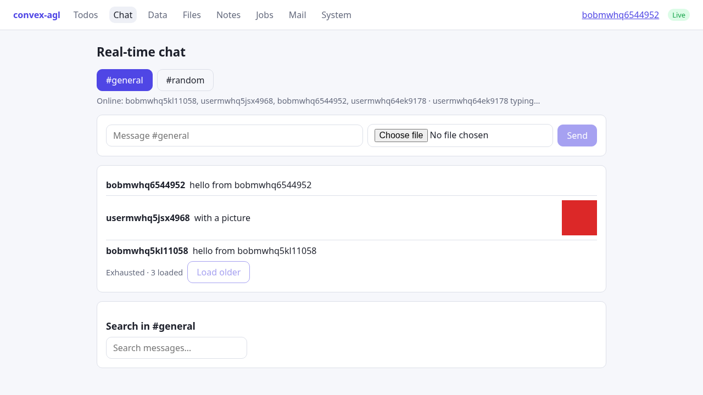
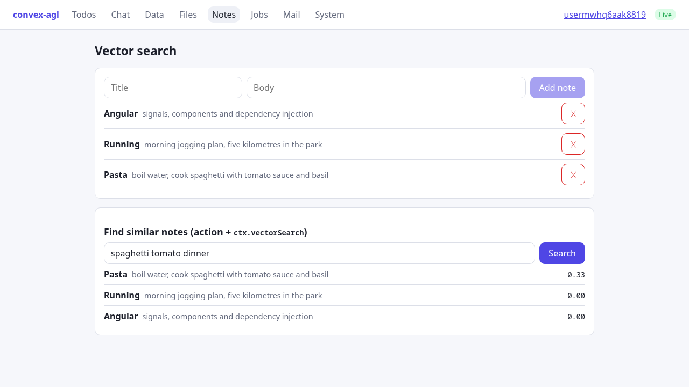
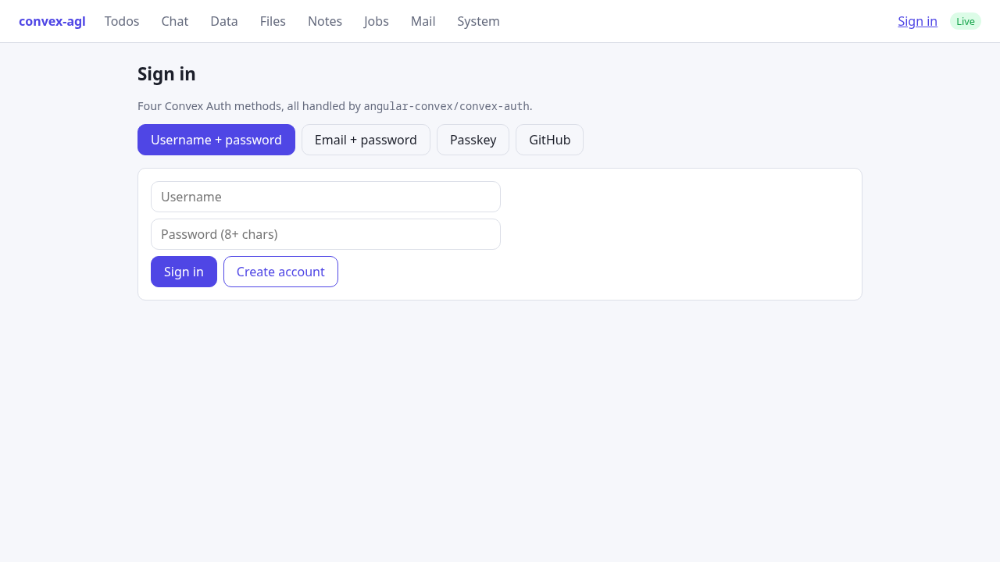
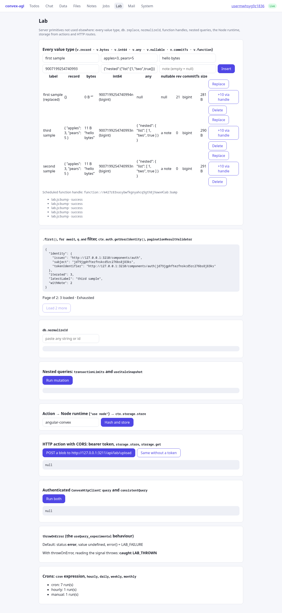
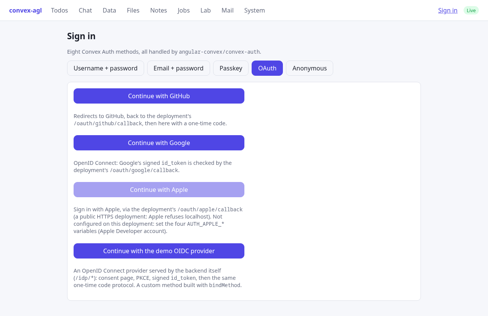
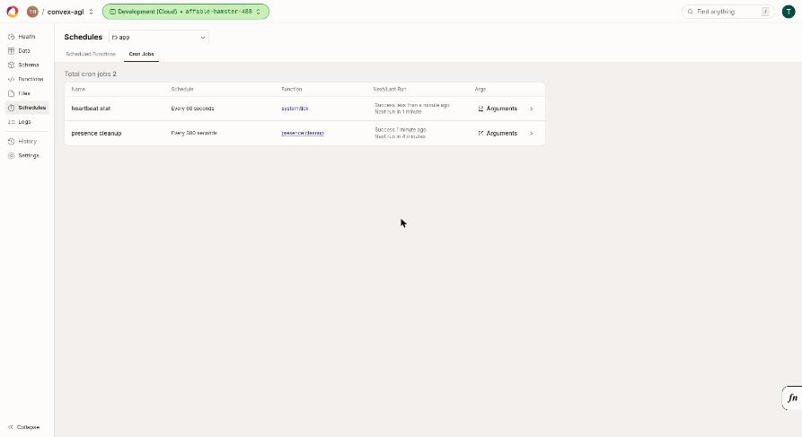
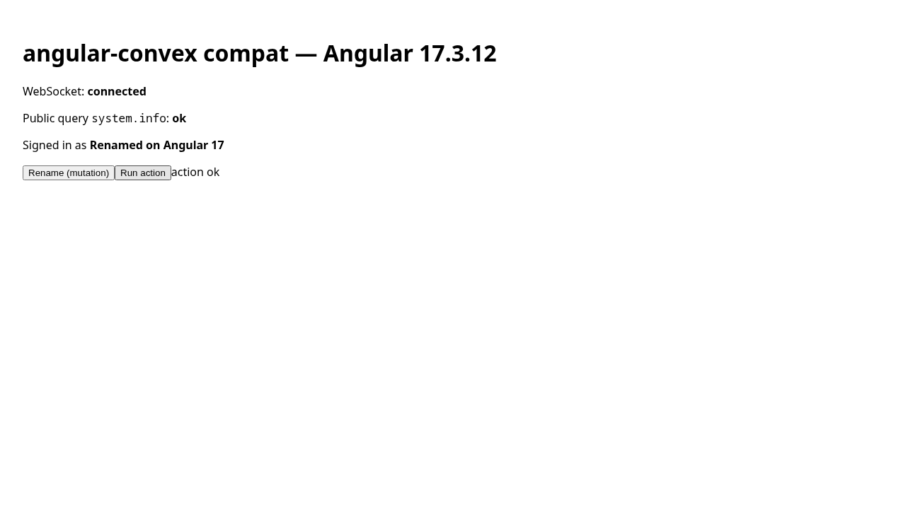

# ngx-convex

[](https://github.com/tibdev78/ngx-convex/actions/workflows/ci.yml) [](https://www.npmjs.com/package/ngx-convex)

Angular bindings for [Convex](https://convex.dev). This repository contains:

| Path | What |
|---|---|
| [`projects/ngx-convex`](projects/ngx-convex) | The library, published as `ngx-convex`. It has three entry points: `ngx-convex`, `ngx-convex/convex-auth` and `ngx-convex/testing`. **API documentation: [library README](projects/ngx-convex/README.md).** |
| [`projects/convex-agl`](projects/convex-agl) | **convex-agl**, a demo app that exercises every feature against a real backend. |
| [`projects/convex-agl/convex`](projects/convex-agl/convex) | The demo's Convex backend: schema, functions, auth, crons, HTTP routes. |
| [`e2e`](e2e) | Playwright end-to-end suite for the demo, run against local or cloud. |
| [`compat`](compat) | Compatibility matrix covering Angular 17 → 22 on Node 20 / 22 / 24. |



## The demo — what it covers

| Page | Convex features |
|---|---|
| **Login / Account** | Convex Auth 2.0 with username + password, email + password (verification link, password recovery, email change), passkeys (autofill, add/remove), GitHub and Google OAuth, Sign in with Apple (ready, enabled by four variables), an OpenID Connect provider served by the backend itself (consent page, PKCE, signed `id_token`), and anonymous accounts. The last two are custom methods built on Convex Auth's `bindMethod`. Route guard, sign-out. |
| **Todos** | Optimistic mutations, filters on an index, per-project stats, full-text **search index**. |
| **Chat** | Real time between users, presence (heartbeat plus a cleanup cron), image messages from **file storage**, paginated history, search. |
| **Data** | 1,000-row seed written in batched mutations, `paginate()` with *load more*, filtering on an **index** (`by_kind`), counts. |
| **Files** | Upload with progress, gallery served from storage URLs, server-side validation, delete. |
| **Notes** | **Vector search** from an action (`ctx.vectorSearch`) with deterministic embeddings. |
| **Jobs** | `ctx.scheduler.runAfter` / `cancel`, job status, a **cron** counter updated live. |
| **Mail** | A local fake Resend component: emails are sent by scheduled mutations and land in an in-app mailbox. No real email leaves the app. |
| **System** | Connection state, typed `ConvexError`s, action → **HTTP route**, one-shot `ConvexHttpClient`. |
| **Lab** | Every value type (`v.int64`, `v.bytes`, `v.record`, `v.any`, `v.nullable`, `v.commitTs`, `v.function`), `db.replace`, `normalizeId`, function handles with `runAfter` / `runAt`, `for await` and `q.and` filters, nested `runQuery` with `transactionLimits`, the **Node runtime**, `storage.store` from an action, a CORS **HTTP route** with a bearer token, an authenticated `ConvexHttpClient`, `throwOnError`, every cron kind, `ctx.db.table()`, `log.audit` from mutations and actions with a live audit trail, `getServiceUrl` / `getServiceToken`, `storage.getMetadata`. |

Every Convex 1.50 and Convex Auth 2.0 feature, with the demo file and the test that covers it, is listed in **[COVERAGE.md](COVERAGE.md)**.

| | | |
|---|---|---|
|  |  |  |
|  |  |  |
|  |  |  |
|  |  |  |
|  | | |

## Run it

Requires Node 22 or 24, which is what the workspace uses (Angular 22).

```bash
npm install
npm run build:lib                                 # the demo imports the built library
CONVEX_AGENT_MODE=anonymous npx convex dev        # local backend on 127.0.0.1:3210, pushes on save
npx ng serve convex-agl                           # http://localhost:4200
```

The backend reads these environment variables (`npx convex env set NAME value`):

| Variable | Purpose |
|---|---|
| `SITE_URL` | Public origin of the app, used in emailed links and the OAuth redirect. Defaults to `http://localhost:4200`. |
| `AUTH_GITHUB_CLIENT_ID` / `AUTH_GITHUB_CLIENT_SECRET` | GitHub OAuth app. Its callback URL is `https://<deployment>.convex.site/oauth/github/callback` (`http://127.0.0.1:3211/oauth/github/callback` for the local backend). |
| `AUTH_GOOGLE_CLIENT_ID` / `AUTH_GOOGLE_CLIENT_SECRET` | Google Cloud OAuth client (type *Web application*). Authorized redirect URI: `https://<deployment>.convex.site/oauth/google/callback` (`http://127.0.0.1:3211/oauth/google/callback` locally). While the consent screen is in *Testing*, only its test users can sign in. |
| `AUTH_APPLE_CLIENT_ID` / `AUTH_APPLE_TEAM_ID` / `AUTH_APPLE_KEY_ID` / `AUTH_APPLE_PRIVATE_KEY` | Sign in with Apple: Services ID, team id, key id and the `.p8` key. Return URL: `https://<deployment>.convex.site/oauth/apple/callback` (Apple refuses localhost). |

Every one of these variables must exist, because the auth components declare them. Set any provider you don't use to `not-configured`: its button is then disabled (the `oauthProviders` query reports it).

### Against a cloud deployment

```bash
npx convex dev --once                              # push to the deployment selected by CONVEX_DEPLOYMENT
npx ng serve convex-agl -c cloud                   # uses src/environments/environment.cloud.ts
```

Point `environment.cloud.ts` at your own deployment.

| | | |
|---|---|---|
|  |  |  |

## Tests

```bash
npx ng test ngx-convex --watch=false           # library unit tests (Vitest)
npx playwright test                                # demo e2e against the local backend
E2E_CONFIG=cloud npx playwright test               # the same suite against the cloud deployment
```

The e2e suite uses the installed Google Chrome (`PW_CHANNEL=chromium` switches to Playwright's own build). It saves a full-page screenshot of every step in `e2e/screenshots/`. Passkeys are tested with a virtual WebAuthn authenticator. The OAuth protocol is tested end to end against the demo OIDC provider; GitHub and Google are tested up to the redirect to the provider, GitHub also end to end with a test account when its secrets are set (see below), Google's full flow was run by hand; Apple is tested in both states, disabled and redirecting.

`scripts/dashboard-cli.sh` runs the dashboard's features (data browser, function runner, inline query, import, export, environment variables, logs, insights) through `npx convex` against the selected deployment.

### Compatibility matrix

```bash
npm run build:lib && (cd dist/ngx-convex && npm pack --pack-destination ../../compat)
compat/run.sh                                      # one `ng new` app per row, built from the tarball
npx playwright test -c compat/playwright.config.ts # runs each build against the backend
```

The script uses [fnm](https://github.com/Schniz/fnm) when it is installed; otherwise the Node on `PATH` must match the row. It exits non-zero if any row fails. The rows are `angular:node:convex`, for example `compat/run.sh 19:20:1.48.0`. Results go to [`compat/RESULTS.md`](compat/RESULTS.md). Rows also accept npm dist-tags, for example `compat/run.sh latest:24:latest`, and `COMPAT_AUTH` sets the `@convex-dev/auth` version (default `2.0.0`).

| Angular 17 on Node 20 | Angular 22 on Node 24 |
|---|---|
|  |  |

### Continuous integration

[`.github/workflows/ci.yml`](.github/workflows/ci.yml) runs three jobs on every push and pull request:

- **library**: builds the library, runs the unit tests, checks `skills/` against the built types (`npm run check:skills`, `npm run test:scripts`) and packs the tarball;
- **e2e**: starts an anonymous local backend ([`scripts/ci-backend.sh`](scripts/ci-backend.sh)), runs the whole Playwright suite, then `scripts/dashboard-cli.sh`;
- **compat**: one job per matrix row, on that row's Node, then runs each build against a local backend.

Run by hand with a `published` version (`gh workflow run ci.yml -f published=0.0.1`), the e2e and compat jobs use that package downloaded from npm instead of the local build, to check what users actually install. The unit tests always run on the sources.

[`.github/workflows/latest.yml`](.github/workflows/latest.yml) runs every Monday (and on demand) against the newest releases: the library's unit tests on `convex@latest` and `@convex-dev/auth@latest`, then the compatibility check with Angular `latest` on Node 22, 24 and the current Node, and Angular `next` (a prerelease failure is reported as a warning only). A failed scheduled run notifies the repository owner, so a breaking release is caught before users hit it.

No secret is needed for the main suite. GitHub and Google are only tested up to the redirect, so placeholder client ids are enough; Apple stays `not-configured` unless the `AUTH_APPLE_*` variables are present.

#### Optional: full GitHub OAuth round trip

With these repository secrets, the e2e job also signs in to GitHub for real and comes back to the app:

| Secret | Value |
|---|---|
| `E2E_GITHUB_OAUTH_CLIENT_ID` / `E2E_GITHUB_OAUTH_CLIENT_SECRET` | A GitHub OAuth app whose callback URL is `http://127.0.0.1:3211/oauth/github/callback` (the CI backend). |
| `E2E_GITHUB_PASSKEY_ID` / `E2E_GITHUB_PASSKEY_KEY` / `E2E_GITHUB_PASSKEY_USER` | A passkey of a dedicated test account (never a personal one), kept for CI: credential id, PKCS#8 private key, user handle, all base64. A passkey satisfies both the password and 2FA, and GitHub does not ask for an emailed device code. |

The test lives in [`e2e/github-roundtrip.spec.ts`](e2e/github-roundtrip.spec.ts) and is tagged `@secrets`. It loads the passkey into a virtual WebAuthn authenticator and clicks *Sign in with a passkey*. So that the private key never lands in a trace or HTML report, this file records no trace, screenshot or video; CI runs it in a separate step (`--grep @secrets --reporter=list`) whose output is never uploaded, and the main step runs `--grep-invert @secrets`. If GitHub refuses the sign-in, the error gives GitHub's own message. Without the secrets the test is skipped.

To create the CI passkey, sign in as the test account and register it in a virtual authenticator, never in a password manager: a manager that already holds a passkey for the account refuses a second one (WebAuthn `excludeCredentials`), and its key cannot reach CI. Either run `scripts/register-github-passkey.mjs` (a visible Chrome; it stores the three secrets itself), or, when the account only signs in through Google, which refuses automated browsers, use your own Chrome: DevTools → WebAuthn → enable the virtual authenticator environment, add a `ctap2` / `internal` authenticator with resident keys and user verification, open *Add a passkey* on GitHub (disable any password-manager extension first), then *Export* the private key and copy the ID and user handle into the secrets. Revoke it from Settings → Password and authentication.

Locally, export the `E2E_GITHUB_*` variables and set the OAuth app with `npx convex env set`. On CI the account's screenshots are not taken, because artifacts of a public repository are public.

#### On a paid Convex team

`E2E_EXPECT_SERVICE_TOKEN=1 E2E_CONFIG=cloud npx playwright test e2e/lab.spec.ts` requires `getServiceToken` to return a token instead of accepting the free-plan refusal.

## Agent skills

`skills/` holds agent skills (Claude Code, Codex) for building Angular apps on Convex with this library. They are not part of the npm package.

- `convex-angular` (original): the Angular counterpart of `convex/react`, with an API map from each React hook to its `inject*` function.
- `convex`, `convex-auth`, `convex-quickstart`: adapted from [get-convex/agent-skills](https://github.com/get-convex/agent-skills) (Apache-2.0, see [`skills/NOTICE`](skills/NOTICE)). The server-side instructions are unchanged; the client side uses ngx-convex.
- 15 backend skills from the same repository, installed unmodified: `convex-expert`, `convex-design`, `convex-reviewer`, `convex-authz`, `convex-migrate`, and so on. The others (billing, hosting, monitoring, ops) are left out; the reason for each is in [`skills/upstream.lock.json`](skills/upstream.lock.json).

```bash
node scripts/convex-skills.mjs install         # into ~/.claude/skills and ~/.agents/skills, at the locked commit
node scripts/convex-skills.mjs check           # what changed upstream since the locked commit, with the diff
node scripts/convex-skills.mjs update          # same report, then asks before installing and locking the new commit
node scripts/convex-skills.mjs reviewed <name> # after re-reading an adapted skill against its new upstream source
```

The script only replaces or removes folders it installed itself (each carries a `.ngx-convex-skills` marker). A skill folder with the same name that it did not create stops the install before anything is written. When an upstream skill that one of the adaptations comes from changes, `check` flags the adaptation as *TO REVIEW*. `npm run check:skills` makes sure every ngx-convex API the skills cite exists in the built types.

## Limits and paid plans

Everything above runs on Convex's free plan, except the features below. The code for each is in place and documented; what is missing is the account or plan.

| Feature | Needs | State in this repository | Without it |
|---|---|---|---|
| Sign in with Apple | A paid Apple Developer account (Services ID, key `.p8`) | Mounted and tested up to Apple's authorize page; the four `AUTH_APPLE_*` variables default to `not-configured`, which disables the button | Apple sign-in is unavailable; every other method works. Apple refuses `localhost`, so it can only be tried on a deployment with a public URL. |
| `getServiceToken` (Convex-managed services such as the AI gateway) | A paid Convex team | Called in the Lab; the e2e test accepts the free-plan refusal, and `E2E_EXPECT_SERVICE_TOKEN=1` requires the token | `getServiceUrl` works everywhere, but no token is issued, so the managed services cannot be called. |
| `log.audit` retention | Convex Enterprise | `log.audit` is called from mutations, and from actions through `ctx.runMutation` (Convex refuses it directly in an action) | The call succeeds on every plan but Convex keeps no consultable audit log. **Workaround used by the demo**: write each event to your own table as well (here `auditEvents`, read live by the `auditTrail` query), in the same mutation as the `log.audit` call, so it is transactional with the change it records. That table is yours to secure, retain and purge: Convex gives it no immutability or retention guarantee. |

### Before opening an app to other users

- **Google**: a new OAuth consent screen is in *Testing*, where only the listed test users can sign in (and their tokens expire after seven days). Publishing it *In production* is done in the Google Cloud console by the app's developer; requesting more than the basic `openid`, `email` and `profile` scopes triggers Google's verification. Each app built on this library configures its own Google project.
- **GitHub**: an OAuth App works for any GitHub user as soon as it exists; only its callback URL must point to the deployment that serves the app.

## License

MIT
