# angular-convex

[](https://github.com/tibdev78/angular-convex/actions/workflows/ci.yml)

Angular bindings for [Convex](https://convex.dev). This repository contains:

| Path | What |
|---|---|
| [`projects/angular-convex`](projects/angular-convex) | The library, published as `angular-convex`. It has three entry points: `angular-convex`, `angular-convex/convex-auth` and `angular-convex/testing`. **API documentation: [library README](projects/angular-convex/README.md).** |
| [`projects/convex-agl`](projects/convex-agl) | **convex-agl**, a demo app that exercises every feature against a real backend. |
| [`projects/convex-agl/convex`](projects/convex-agl/convex) | The demo's Convex backend: schema, functions, auth, crons, HTTP routes. |
| [`e2e`](e2e) | Playwright end-to-end suite for the demo, run against local or cloud. |
| [`compat`](compat) | Compatibility matrix covering Angular 17 → 22 on Node 20 / 22 / 24. |


## The demo — what it covers

| Page | Convex features |
|---|---|
| **Login / Account** | Convex Auth 2.0 with username + password, email + password (verification link, password recovery, email change), passkeys (autofill, add/remove), GitHub and Google OAuth, Sign in with Apple (ready, enabled by four variables), an OpenID Connect provider served by the backend itself (consent page, PKCE, signed `id_token`), and anonymous accounts. The last two are custom methods built on Convex Auth's `bindMethod`. Route guard, sign-out. |
| **Todos** | Optimistic mutations, filters on an index, per-project stats, full-text **search index**. |
| **Chat** | Real time between users, presence (heartbeat plus a cleanup cron), image messages from **file storage**, paginated history, search. |
| **Data** | 1,000-row seed written in batched mutations, `paginate()` with *load more*, filtering on an **index** (`by_kind`), counts. |
| **Files** | Upload with progress, gallery served from storage URLs, server-side validation, delete. |
| **Notes** | **Vector search** from an action (`ctx.vectorSearch`) with deterministic embeddings. |
| **Jobs** | `ctx.scheduler.runAfter` / `cancel`, job status, a **cron** counter updated live. |
| **Mail** | A local fake Resend component: emails are sent by scheduled mutations and land in an in-app mailbox. No real email leaves the app. |
| **System** | Connection state, typed `ConvexError`s, action → **HTTP route**, one-shot `ConvexHttpClient`. |
| **Lab** | Every value type (`v.int64`, `v.bytes`, `v.record`, `v.any`, `v.nullable`, `v.commitTs`, `v.function`), `db.replace`, `normalizeId`, function handles with `runAfter` / `runAt`, `for await` and `q.and` filters, nested `runQuery` with `transactionLimits`, the **Node runtime**, `storage.store` from an action, a CORS **HTTP route** with a bearer token, an authenticated `ConvexHttpClient`, `throwOnError`, every cron kind, `ctx.db.table()`, `log.audit` from mutations and actions with a live audit trail, `getServiceUrl` / `getServiceToken`, `storage.getMetadata`. |

Every Convex 1.50 and Convex Auth 2.0 feature, with the demo file and the test that covers it, is listed in **[COVERAGE.md](COVERAGE.md)**.

| | | |
|---|---|---|
| 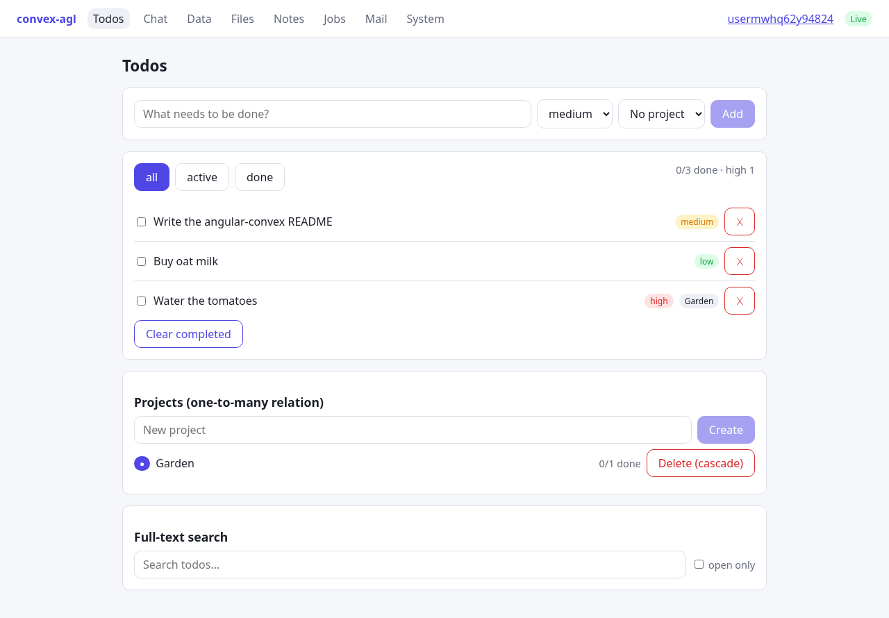 | 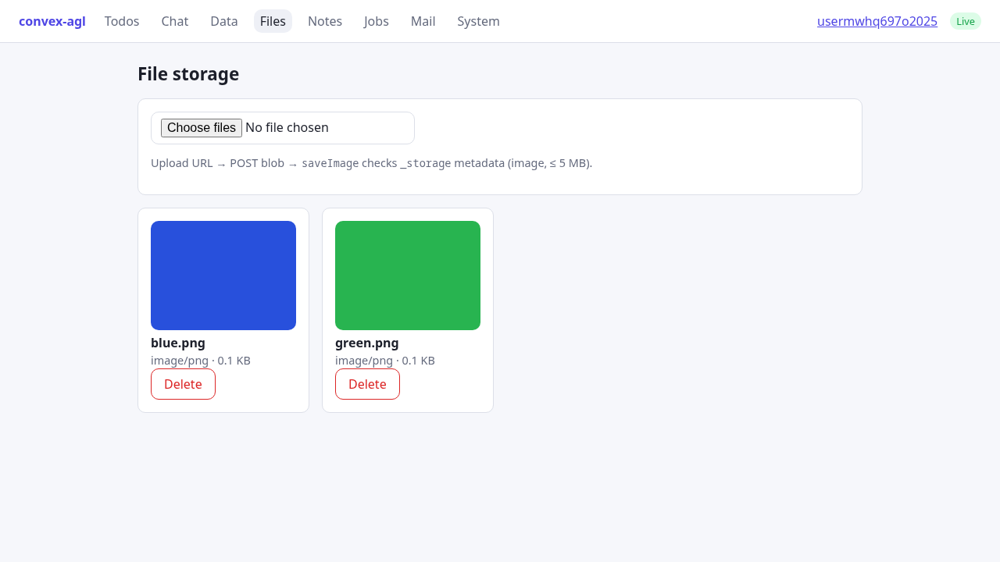 |  |
| 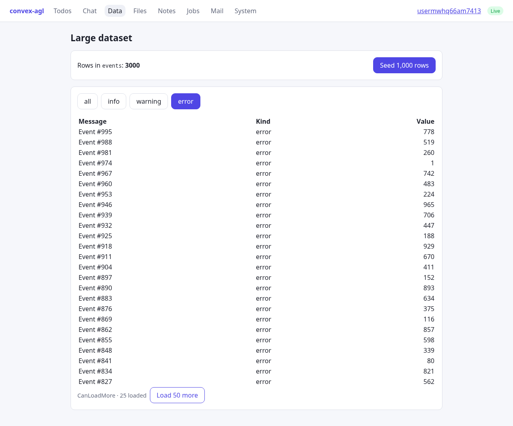 | 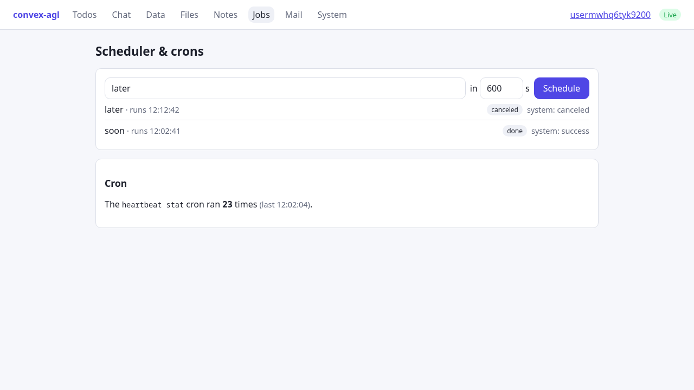 | 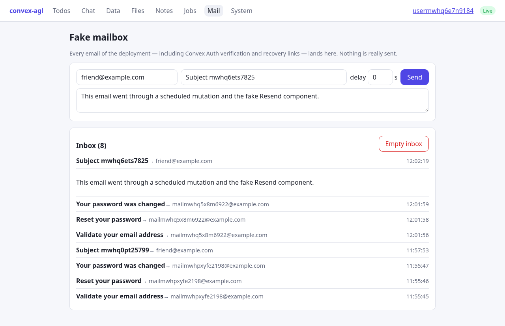 |
| 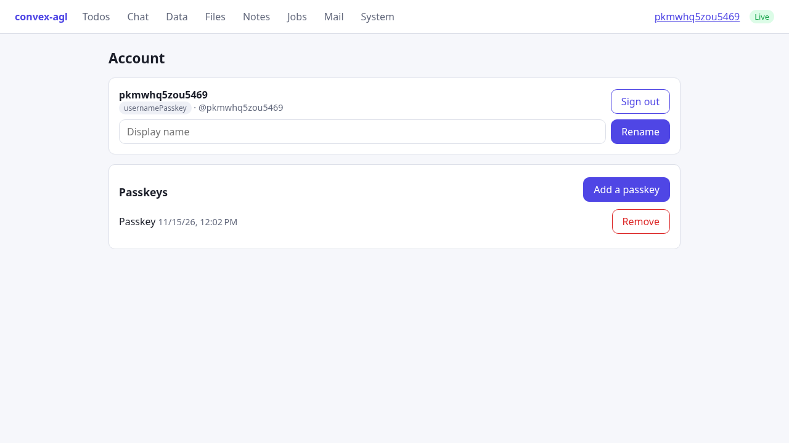 |  | 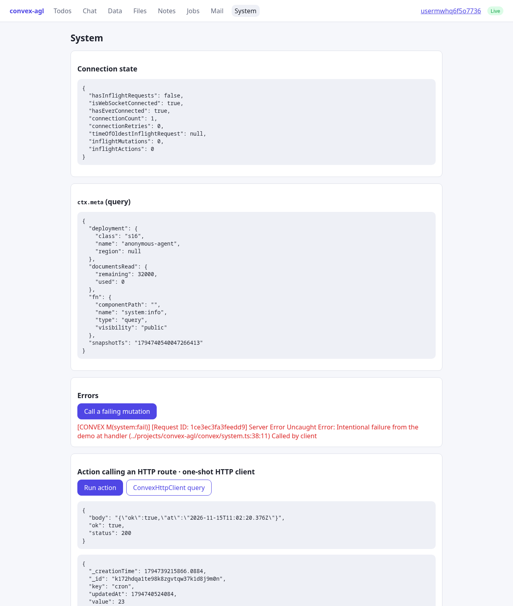 |
|  | 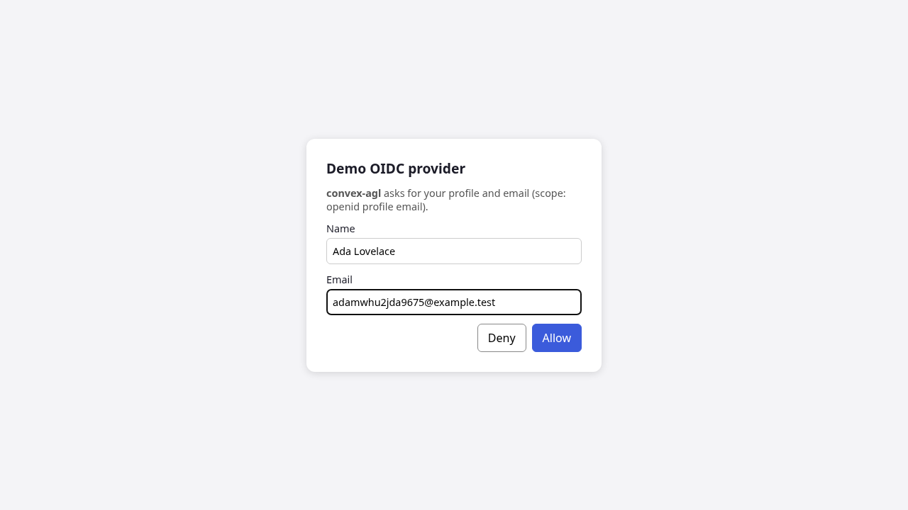 | 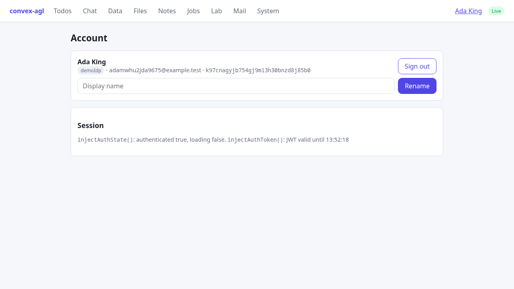 |
|  | | |

## Run it

Requires Node 22 or 24, which is what the workspace uses (Angular 22).

```bash
npm install
npm run build:lib                                 # the demo imports the built library
CONVEX_AGENT_MODE=anonymous npx convex dev        # local backend on 127.0.0.1:3210, pushes on save
npx ng serve convex-agl                           # http://localhost:4200
```

The backend reads these environment variables (`npx convex env set NAME value`):

| Variable | Purpose |
|---|---|
| `SITE_URL` | Public origin of the app, used in emailed links and the OAuth redirect. Defaults to `http://localhost:4200`. |
| `AUTH_GITHUB_CLIENT_ID` / `AUTH_GITHUB_CLIENT_SECRET` | GitHub OAuth app. Its callback URL is `https://<deployment>.convex.site/oauth/github/callback` (`http://127.0.0.1:3211/oauth/github/callback` for the local backend). |
| `AUTH_GOOGLE_CLIENT_ID` / `AUTH_GOOGLE_CLIENT_SECRET` | Google Cloud OAuth client (type *Web application*). Authorized redirect URI: `https://<deployment>.convex.site/oauth/google/callback` (`http://127.0.0.1:3211/oauth/google/callback` locally). While the consent screen is in *Testing*, only its test users can sign in. |
| `AUTH_APPLE_CLIENT_ID` / `AUTH_APPLE_TEAM_ID` / `AUTH_APPLE_KEY_ID` / `AUTH_APPLE_PRIVATE_KEY` | Sign in with Apple: Services ID, team id, key id and the `.p8` key. Return URL: `https://<deployment>.convex.site/oauth/apple/callback` (Apple refuses localhost). |

Every one of these variables must exist, because the auth components declare them. Set any provider you don't use to `not-configured`: its button is then disabled (the `oauthProviders` query reports it).

### Against a cloud deployment

```bash
npx convex dev --once                              # push to the deployment selected by CONVEX_DEPLOYMENT
npx ng serve convex-agl -c cloud                   # uses src/environments/environment.cloud.ts
```

Point `environment.cloud.ts` at your own deployment.

| | | |
|---|---|---|
| 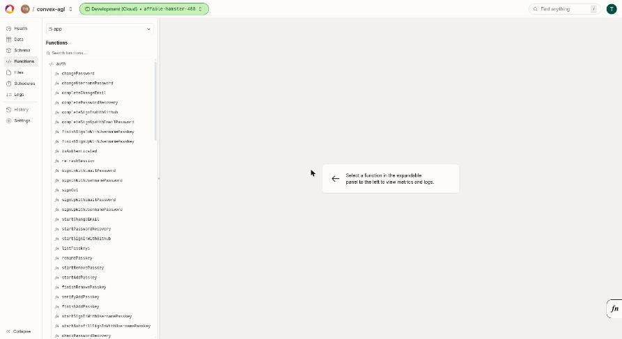 | 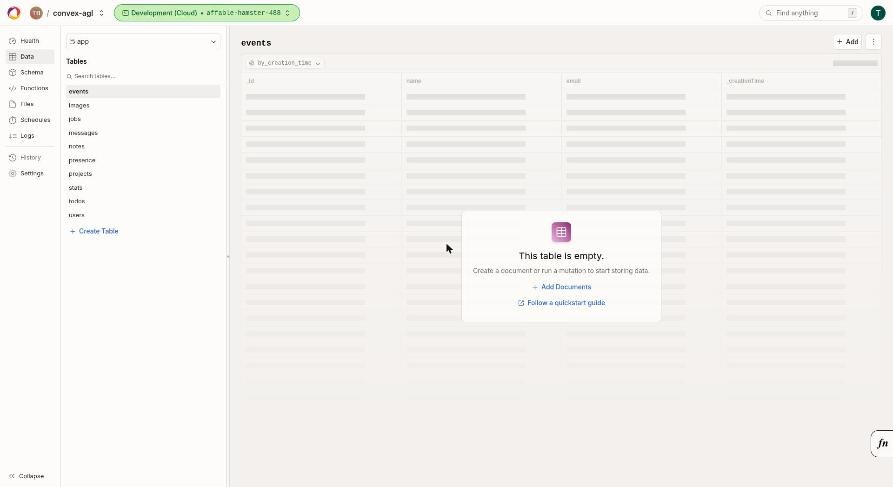 |  |

## Tests

```bash
npx ng test angular-convex --watch=false           # library unit tests (Vitest)
npx playwright test                                # demo e2e against the local backend
E2E_CONFIG=cloud npx playwright test               # the same suite against the cloud deployment
```

The e2e suite uses the installed Google Chrome (`PW_CHANNEL=chromium` switches to Playwright's own build). It saves a full-page screenshot of every step in `e2e/screenshots/`. Passkeys are tested with a virtual WebAuthn authenticator. The OAuth protocol is tested end to end against the demo OIDC provider; GitHub and Google are tested up to the redirect to the provider (their full flows were run by hand); Apple is tested in both states, disabled and redirecting.

`scripts/dashboard-cli.sh` runs the dashboard's features (data browser, function runner, inline query, import, export, environment variables, logs, insights) through `npx convex` against the selected deployment.

### Compatibility matrix

```bash
npm run build:lib && (cd dist/angular-convex && npm pack --pack-destination ../../compat)
compat/run.sh                                      # one `ng new` app per row, built from the tarball
npx playwright test -c compat/playwright.config.ts # runs each build against the backend
```

The script uses [fnm](https://github.com/Schniz/fnm) when it is installed; otherwise the Node on `PATH` must match the row. It exits non-zero if any row fails. The rows are `angular:node:convex`, for example `compat/run.sh 19:20:1.48.0`. Results go to [`compat/RESULTS.md`](compat/RESULTS.md). Run it again for every new Angular major.

| Angular 17 on Node 20 | Angular 22 on Node 24 |
|---|---|
|  | 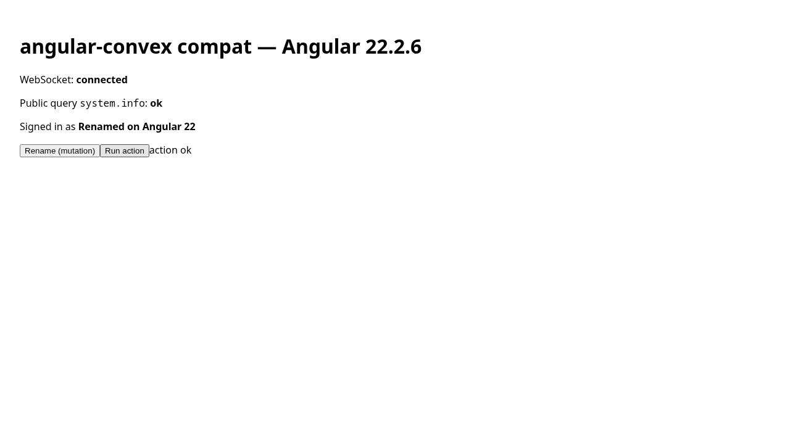 |

### Continuous integration

[`.github/workflows/ci.yml`](.github/workflows/ci.yml) runs three jobs on every push and pull request:

- **library**: builds the library, runs the unit tests and packs the tarball;
- **e2e**: starts an anonymous local backend ([`scripts/ci-backend.sh`](scripts/ci-backend.sh)), runs the whole Playwright suite, then `scripts/dashboard-cli.sh`;
- **compat**: one job per matrix row, on that row's Node, then runs each build against a local backend.

No secret is needed for the main suite. GitHub and Google are only tested up to the redirect, so placeholder client ids are enough; Apple stays `not-configured` unless the `AUTH_APPLE_*` variables are present.

#### Optional: full GitHub OAuth round trip

With these repository secrets, the e2e job also signs in to GitHub for real and comes back to the app:

| Secret | Value |
|---|---|
| `E2E_GITHUB_OAUTH_CLIENT_ID` / `E2E_GITHUB_OAUTH_CLIENT_SECRET` | A GitHub OAuth app whose callback URL is `http://127.0.0.1:3211/oauth/github/callback` (the CI backend). |
| `E2E_GITHUB_LOGIN` / `E2E_GITHUB_PASSWORD` | A dedicated test account, never a personal one. |
| `E2E_GITHUB_TOTP_SECRET` | The base32 key of the account's authenticator-app 2FA. Without 2FA, GitHub sends an emailed device code from a new machine, which a test cannot read. |

The test lives in [`e2e/github-roundtrip.spec.ts`](e2e/github-roundtrip.spec.ts) and is tagged `@secrets`. Playwright writes every `fill` value into its trace and HTML report, so this file records no trace, screenshot or video. CI runs it in a separate step (`--grep @secrets --reporter=list`) whose output is never uploaded; the main step runs `--grep-invert @secrets`. If GitHub refuses the sign-in, the error gives GitHub's message and the shape of the credentials (lengths, stray whitespace), never their values. Without the secrets the test is skipped. Locally, without `E2E_GITHUB_TOTP_SECRET`, it waits for the 2FA code to be typed in the browser (`--headed`). `scripts/check-github-password.mjs` checks the account's password alone, on the real GitHub login page, without printing it.

Locally, export the `E2E_GITHUB_*` variables and set the OAuth app with `npx convex env set`. On CI the account's screenshots are not taken, because artifacts of a public repository are public.

#### On a paid Convex team

`E2E_EXPECT_SERVICE_TOKEN=1 E2E_CONFIG=cloud npx playwright test e2e/lab.spec.ts` requires `getServiceToken` to return a token instead of accepting the free-plan refusal.

## License

MIT
